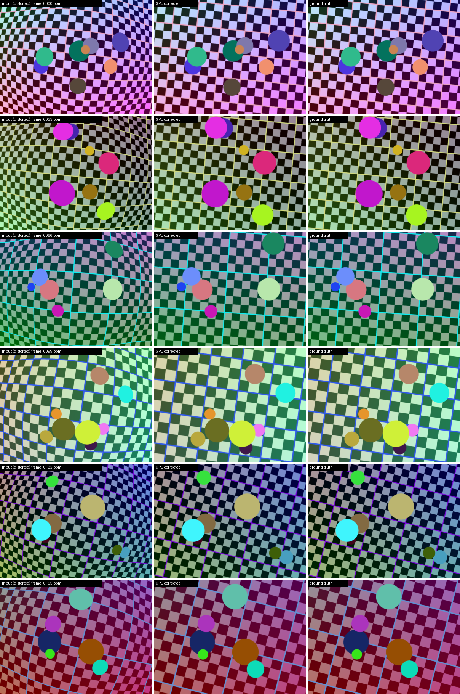

# CUDA Batch Lens Undistortion

GPU-accelerated correction of wide-angle (barrel) lens distortion for large
batches of images, written for the *CUDA at Scale for the Enterprise*
independent project.

A Brown-Conrady lens model (radial `k1 k2 k3`, tangential `p1 p2`) is inverted
for every pixel of every frame. The program streams a directory of images
through the GPU with several CUDA streams, checks the GPU output against a
CPU reference, and measures image quality against exact ground truth.



*Left: distorted input. Middle: GPU-corrected output. Right: ground truth.*
(The image above appears once `./run.sh` has been executed and `output/samples`
committed.)

## Highlights

* **Three GPU back ends** behind one CLI flag
  * `kernel_map` - custom CUDA kernel builds a float undistortion map once per
    resolution; a second custom kernel remaps every frame (bilinear or nearest).
  * `kernel_fused` - one custom kernel evaluates the lens model and samples in
    the same thread, trading memory traffic for arithmetic.
  * `npp` - the same map fed to NVIDIA NPP `nppiRemap_8u_C3R_Ctx`.
* **Multi-stream batch pipeline** - pinned host buffers, async H2D / kernel /
  D2H per stream, and disk I/O on the CPU overlapped with GPU work.
* **Built-in verification** - the first N GPU results are compared
  pixel-for-pixel with a single-threaded CPU implementation that shares the
  exact same `__host__ __device__` math.
* **Measurable quality** - a synthetic dataset generator renders each scene
  analytically both through the lens and through an ideal pinhole camera, so
  PSNR of the corrected image against ground truth is exact.
* **Scale** - 200 frames at 800x600 plus 20 frames at 2560x1440 by default
  (hundreds of small images *and* tens of large ones).
* Google C++ Style (checked with `cpplint`), no third-party C++ dependencies.

## Repository layout

```
.
├── Makefile                  build, data, run, lint, clean
├── run.sh                    full demo: build -> data -> all back ends -> proof
├── CPPLINT.cfg               Google style checker configuration
├── src/
│   ├── main.cu               entry point
│   ├── cli_options.{h,cc}    command-line parsing
│   ├── camera_model.{h,cc}   lens model + sampling (host/device shared)
│   ├── undistort_gpu.{h,cu}  CUDA kernels and NPP wrapper
│   ├── undistort_cpu.{h,cc}  CPU reference implementation
│   ├── batch_pipeline.{h,cu} multi-stream batch processing + reporting
│   ├── image_io.{h,cc}       PPM (P6) reader/writer, directory listing
│   └── metrics.{h,cc}        PSNR and diff statistics
├── scripts/
│   ├── make_dataset.py       synthetic distorted + ground-truth dataset
│   ├── make_contact_sheet.py before/after PNGs
│   └── package_artifacts.sh  bundles logs + samples into artifacts.tar.gz
└── output/                   logs, metrics.csv, samples (committed after a run)
```

## Requirements

* NVIDIA GPU with compute capability 5.2 or newer
* CUDA Toolkit 11.1+ (nvcc, cudart, NPP - all ship with the toolkit)
* g++ with C++17 support, GNU make
* Python 3 with `numpy` (dataset) and `Pillow` (before/after PNGs, optional)

Tested build: CUDA 12.0, g++ 12, Ubuntu 24.04.

## Quick start

```bash
./run.sh            # build, generate data, run everything, write artifacts.tar.gz
```

Or step by step:

```bash
make                # -> bin/lens_undistort
make data           # -> data/distorted, data/ground_truth, data/camera.txt
./bin/lens_undistort --input_dir data/distorted --camera data/camera.txt \
    --gt_dir data/ground_truth --backend kernel_map --streams 4 \
    --output_dir output/corrected --csv output/metrics.csv
```

Build options:

| Variable | Default | Purpose |
|---|---|---|
| `ARCH` | sm_52 ... sm_86 + PTX | e.g. `make ARCH="-arch=sm_75"` for one GPU |
| `CCBIN` | (nvcc default) | host compiler, e.g. `make CCBIN=g++-12` if nvcc rejects your gcc |

`run.sh` honours `COUNT`, `WIDTH`, `HEIGHT`, `STREAMS`, `LARGE` (0/1),
`LARGE_COUNT`, `LARGE_WIDTH`, `LARGE_HEIGHT` environment variables.

## Command-line interface

```
bin/lens_undistort --input_dir DIR [options]
```

| Flag | Default | Meaning |
|---|---|---|
| `--input_dir DIR` | required | directory of distorted `*.ppm` images |
| `--camera FILE` | - | lens file with `focal_scale,k1,k2,k3,p1,p2` (`key=value`) |
| `--focal_scale F` | 0.6 | `fx = fy = F * width`, principal point at the centre |
| `--k1 --k2 --k3 F` | 0 | radial coefficients (override the camera file) |
| `--p1 --p2 F` | 0 | tangential coefficients |
| `--zoom F` | 1.0 | output focal multiplier (< 1 keeps more of the curved border) |
| `--backend NAME` | `kernel_map` | `kernel_map`, `kernel_fused`, `npp`, `cpu` |
| `--interp NAME` | `bilinear` | `bilinear` or `nearest` |
| `--streams N` | 4 | number of CUDA streams / in-flight frames (1-32) |
| `--device N` | 0 | CUDA device index |
| `--limit N` | all | process only the first N images |
| `--output_dir DIR` | `output/corrected` | where corrected images are written |
| `--no_write` | off | skip writing images (pure benchmark) |
| `--gt_dir DIR` | - | ground-truth images with the same names -> PSNR |
| `--verify N` | 8 | compare the first N GPU results with the CPU reference |
| `--csv FILE` | - | per-image timings, PSNR and verification diff |
| `--quiet` | off | print only the summary |
| `--help` | | usage |

Exit code is non-zero on I/O errors or if a custom-kernel result differs from
the CPU reference by more than 2 grey levels.

### Using your own images

Any lens/camera can be used: convert images to binary PPM (e.g.
`mogrify -format ppm *.jpg` with ImageMagick, or Pillow) and pass the lens
coefficients from an OpenCV calibration (`k1 k2 p1 p2 k3`, with
`focal_scale = fx / width`).

## How it works

### Lens model

For an output (corrected) pixel `(u, v)` with normalised coordinates
`x = (u - cx) / fx'`, `y = (v - cy) / fy'`:

```
r^2    = x^2 + y^2
radial = 1 + k1 r^2 + k2 r^4 + k3 r^6
x_d    = x * radial + 2 p1 x y + p2 (r^2 + 2 x^2)
y_d    = y * radial + p1 (r^2 + 2 y^2) + 2 p2 x y
src    = (fx * x_d + cx, fy * y_d + cy)
```

Because the *forward* model is evaluated per output pixel, undistortion needs
no iterative inversion on the GPU. The source is then sampled bilinearly
(pixel centres on integer coordinates, black outside the frame).
`MapOutputToSource` and `SampleRgb` in `src/camera_model.h` are
`__host__ __device__`, so the CPU reference runs literally the same code.

### Kernels

* `BuildMapKernel` - one thread per output pixel, writes `map_x`, `map_y`
  (structure of arrays so both loads are coalesced). Runs once per resolution.
* `RemapKernel<Interp>` - one thread per output pixel, reads its two map
  entries and 4 neighbouring RGB pixels, writes 3 bytes. The interpolation mode
  is a template parameter, so there is no per-pixel branch.
* `FusedUndistortKernel<Interp>` - recomputes the lens model instead of
  loading the map (~20 FLOPs instead of 8 bytes of memory traffic per pixel).
* Block size 32x8: one warp covers 32 consecutive pixels of a row.

### Batch pipeline

```
image i -> slot i % K      (K = --streams)

 CPU:  [finish slot: verify, PSNR, write PPM] [read next PPM into pinned h_in]
 GPU stream k:   H2D(h_in -> d_in) -> kernel(d_in -> d_out) -> D2H(d_out -> h_out)
```

Each slot owns a non-blocking CUDA stream, pinned input/output host buffers,
device buffers and four CUDA events (begin, after H2D, after kernel, after
D2H) for precise per-stage timing. While the CPU finishes the oldest slot and
decodes the next file straight into pinned memory, the other K-1 frames are
being copied and processed on the GPU.

## Output and proof of execution

`./run.sh` writes:

| Path | Content |
|---|---|
| `output/logs/kernel_map.log` | main run: every image with timings, PSNR and verification |
| `output/logs/kernel_fused.log`, `npp.log` | the other GPU back ends on the same data |
| `output/logs/streams_{1,2,4,8}.log` | stream-count sweep |
| `output/logs/cpu_reference.log` | single-threaded CPU baseline |
| `output/logs/large_kernel_map.log` | 20 frames at 2560x1440 |
| `output/logs/environment.log` | GPU, driver and nvcc versions |
| `output/logs/summary.txt` | key lines of every log |
| `output/metrics.csv` | per-image metrics of the main run |
| `output/samples/*.png` | before / after / ground-truth comparisons |
| `artifacts.tar.gz` | all of the above, ready to upload |

Corrected PPMs (`output/corrected*/`) and the datasets are git-ignored because
they are hundreds of MB; they are regenerated deterministically by `run.sh`.

## Results

Fill in from `output/logs/summary.txt` after running on the lab GPU.

| Back end | compute ms / 800x600 frame | MP/s | max diff vs CPU |
|---|---|---|---|
| CPU (1 thread) | ~6 | ~80 | - |
| `kernel_map` | | | |
| `kernel_fused` | | | |
| `npp` | | | |

Image quality on the synthetic set (CPU reference, identical math): mean PSNR
against ground truth rises from **~9 dB** for the distorted input to
**~30 dB** after correction. The remaining error is bilinear blur at hard
checkerboard edges where the lens compressed several scene pixels into one.

## License

MIT - see `LICENSE`.
